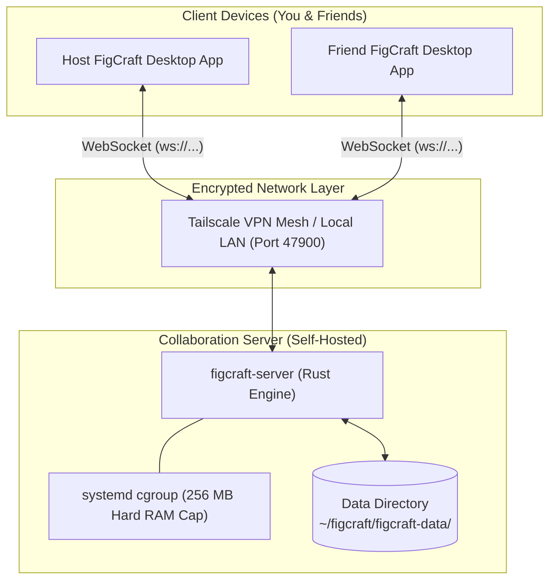
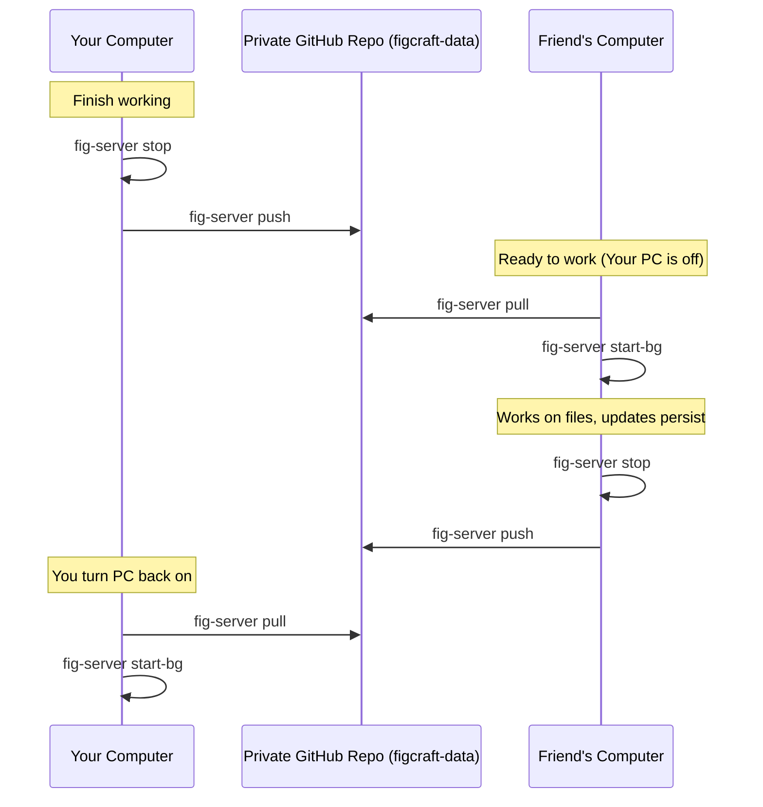

# FigCraft Collaboration Server — Complete Setup & Guide

A universal, production-ready setup for running a self-hosted [FigCraft](https://github.com/storytold/figcraft) real-time collaboration server on Linux with **fish shell**, **Tailscale**, **systemd**, and **GitHub**.

---

## 📖 Architecture & How It Works

FigCraft is a pure Rust, clean-room interface design application (similar to Figma) with local-first storage. It operates across two primary components:



1. **The Desktop Editor (`figcraft`)**: The graphical app used to create, draw, and prototype interfaces.
2. **The Collab Server (`figcraft-server`)**: A lightweight native daemon that manages rooms, relays cursor chat, cursor movements, and synchronizes vector operations in real-time.
3. **RAM Guardrail**: Runs under a transient systemd cgroup capping total memory usage to **256 MB**. The server typically consumes only 5–15 MB RSS at rest.
4. **Network Privacy**: Operates behind your private Tailscale VPN. No open public router ports or CGNAT headaches required.

---

## 📂 Where Files Are Stored

All persistent server state lives in:
```
~/figcraft/figcraft-data/
├── server.key           # MASTER KEY: Grants full admin & publishing access (DO NOT SHARE)
├── server.json          # Server runtime state & active port
├── server.toml          # Server network configuration (listen address & public_url)
├── LOCK                 # Single-instance file lock (prevents dual-server corruption)
└── files/
    └── <16-hex-file-id>/
        ├── snapshot.bin # Latest compacted snapshot of canvas nodes
        ├── log.bin      # Incremental change log between snapshots
        ├── links.json   # Hashed tokens for active edit/view links
        └── meta.json    # File title, creation date, size, and owners
```

> [!IMPORTANT]
> The server stores files in its internal streaming format (`snapshot.bin` + `log.bin`). While inside a session, you can export a standard standalone `.figcraft` document anytime via **File ▸ Save** in the desktop app.

---

## 👥 How to Invite Friends (Live Real-Time Editing)

### Step 1: Friend Joins Your Tailscale Network
Have your friend install Tailscale on their computer and join your Tailscale tailnet (or share your machine using [Tailscale Node Sharing](https://tailscale.com/kb/1084/sharing)).

### Step 2: Publish Your File to Your Server
1. In your FigCraft desktop app, open your design file (e.g., `sb.fig`).
2. Run in terminal:
   ```fish
   fig-server key
   ```
   *Copy the output URL: `ws://<your-tailscale-ip>:47900/?key=<your-key>`*
3. In the FigCraft app, click **File ▸ Publish to server…**, paste that address, and click **Publish**.

### Step 3: Generate and Share the Join Link
Run:
```fish
fig-server link          # Generates an edit link
fig-server link view     # Generates a read-only link
```

Send the resulting link (e.g. `figcraft://join?host=100.x.x.x:47900&file=...&token=...`) to your friend. When they click it or paste it into **Share ▸ Join with a code**, both of you will see each other's live cursors and edits instantly!

---

## 🔄 Multi-Host Replication (Friend Runs the SAME Server)

If you turn off your PC and your friend wants to host the **exact same server with the exact same files and edit history**, use the **Data Repository Handoff Pattern**:



### Initial Setup on Friend's PC:
1. Clone this setup repository:
   ```fish
   git clone https://github.com/<your-username>/figcraft-server-setup ~/figcraft-server-setup
   cp ~/figcraft-server-setup/config/fig-server.fish ~/.config/fish/functions/
   ```
2. Clone your private data repository:
   ```fish
   git clone https://github.com/<your-username>/figcraft-data ~/figcraft/figcraft-data
   ```
3. Generate a local server key for them:
   ```fish
   ~/figcraft/target/release/figcraft-server --data ~/figcraft/figcraft-data key
   ```
4. Update `~/figcraft/figcraft-data/server.toml` with their Tailscale IP:
   ```fish
   set ts_ip (tailscale ip -4)
   printf 'listen = "0.0.0.0:47900"\ndata = "%s/figcraft/figcraft-data"\npublic_url = "ws://%s:47900/"\n' $HOME $ts_ip > ~/figcraft/figcraft-data/server.toml
   ```

---

## 🔒 Security & Privacy Best Practices

- **Never commit `server.key`**: Whoever has this key can edit, publish, or purge any file on the server. The repo's `.gitignore` automatically excludes it.
- **Never commit `figcraft-data/files/` directly to public git**: Design snapshots grow rapidly in size and contain unencrypted binary layers. Use private Git repos for data handoffs and `fig-server backup` for offline archives.
- **Tailscale Isolation**: Because `public_url` points to a Tailscale IP, only devices authenticated to your private VPN can ever establish WebSocket connections.

---

## ⚡ Quick Reference Commands

```fish
# Lifecycle
fig-server start-bg        # Launch in background with 256 MB RAM cap
fig-server status          # Check live health, RAM, PID, and addresses
fig-server ram             # Full memory diagnostics (server + system)
fig-server log             # Stream live journal logs
fig-server stop            # Gracefully stop the server

# Collaboration
fig-server key             # Print master publishing URL
fig-server files           # List all published files
fig-server link            # Generate live edit invite link
fig-server link view       # Generate live view invite link
fig-server links <ID>      # List all active links for a file
fig-server revoke <ID> <L> # Revoke an active link

# Backup & Sync
fig-server backup          # Local timestamped archive in ~/figcraft-backups/
fig-server push            # Push metadata snapshot to GitHub
fig-server pull            # Pull latest changes from GitHub
```
